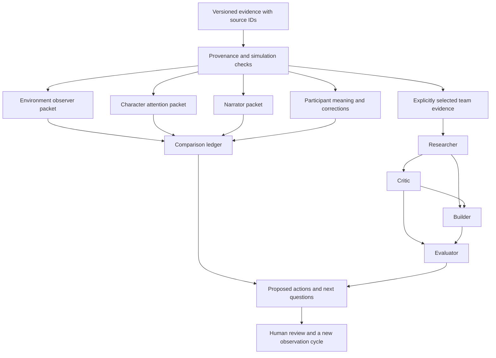

# The observer prototype within the Aura pattern cycle

The local runtime implements one supporting component of Aura: separate what the world model contains, what the focal character noticed, and what the narrator says, then preserve the person's own explanation alongside them. It produces a portable record of evidence, disagreement, proposed action and review. The supplied demonstration also walks a four-role team through a reference-only community-workshop concept.

The full Aura process organises patterns through seven nested horn tori, programmable facets and outward layer stacks, then selects compositions for AI generation, correction and regrouping across selves and access domains. This observer runtime does not implement that whole engine. See [the pattern-cycle guide](guide-aura.html) for the corrected architecture.

The first observer demonstration is simple:

```text
python runtime/aura.py demo --output .private/runs/demo.json
```

This creates a labelled simulation without calling a model or contacting an external service. The detailed [runtime guide](../runtime/README.md) explains the evidence format, budgets and optional local inference adapter.

## Architecture



The arrows show this implementation's data flow. They are an authored extension, not a claim that the source spreadsheets supplied a complete executable graph. The three observer identities follow the Genesis/teacher material: environment, character-attention and narrator. The participant's meaning is a separate account; researcher, critic, builder and evaluator are task roles rather than new definitions of the observers.

## Walk through the demonstration

In the invented world, a workshop moves from Room A to Room B. The character's attention log contains the original invitation and an accessibility request, with no updated timetable. The narrator sees preparation for Room A and tentatively suggests reluctance to change. The narrator also records that the cause is unknown.

The participant's simulated explanation is that the update was missed. A separate correction asks that the initial interpretation remain in the history but not be treated as a character trait. These are invented teaching lines, not Luke's answers or an observed learner interaction.

The runtime gives the environment packet the room-change record. The attention packet does not receive Room B merely because the coordinator knows it. The narrator packet receives behaviour and its tentative interpretation. The participant account remains outside all three packets. The comparison ledger links disagreement and correction while preserving the original inference.

The proposed next step is to ask which information was used and design a replay changing one cue. The runtime does not claim the replay happened or that the revised cue worked. A later observed run must supply that evidence.

## Make the team useful without blurring evidence

The coordinator supplies four bounded tasks. The researcher frames a workshop service question and what would count as useful demand evidence. The critic searches for unsupported assumptions and missing perspectives. The builder provides a mock path from discovery through an unsent expression of interest to simulated confirmation. The evaluator defines a comparison task and failure criteria.

The offline demonstration's outputs are fixed templates. It demonstrates scheduling, dependencies, evidence selection and labelled output handling; it does not demonstrate autonomous research, customer demand or a functioning business. The team receives only `swarm_evidence_ids` explicitly chosen in the input. It has no booking, payment, email, account, medical or device tools.

This leaves a clear route to more capable work. A future tool adapter needs a declared purpose, exact evidence scope, supported actions, permission checks, result provenance, cost limits, failure handling and an independent evaluation. Producing an attractive proposal is not evidence that the proposed intervention works. The next development step can be a real local model for interpretation, a reviewed research adapter or a separate mock business application, with its capabilities named accurately.

## Records that can change without losing their history

A record carries a stable ID, observer stream, claim kind, evidence class, simulation flag, source IDs, text and observed-time field. It can refer to earlier records through derivation, conflict or supersession links. Append a correction rather than replacing the source statement. Preserve an explicit unknown when evidence is absent.

The runtime rejects a simulation source inside a real record set, a derived interpretation relabelled as a measurement, an unknown source ID, a correction pointing to a later or nonexistent record, and unsupported executable fields. It records permission for public or third-party release as `none`. This is a local validation and preparation tool, not a cryptographic provenance system: the input author's truthful classification remains essential.

No whole-person completeness score is computed. The MVS is useful when it supplies reviewed context for the person's selected task, supports correction, and makes its gaps legible. A person can remain partly unknown without the programme treating them as incomplete.

## Place it inside the 120-hour programme

Use G23–G26 to build and compare the three streams. Use the repair/replay work to observe whether a changed cue alters an outcome. Use the expert-team encounters to replace a fixed template with a reviewed artefact and an explicit evaluation. Use T28 to teach another adult to distinguish world facts, noticed cues, narrator interpretations and participant meaning.

During a hyper-busy session, capture one episode with its source and uncertainty, then return for a fuller comparison. Record actual time spent in the programme ledger; running the demonstration does not award curriculum hours or teacher competence automatically. A machine-generated draft does not become a completed practicum.

The final portable archive can contain the original evidence, separate prompts, interpretations, corrections, budget record, proposed actions and evaluated outcomes. Private evidence stays outside the public companion website. A deliberately approved public example is a separate release, with simulations still identified as simulations.

## Optional local inference and current limits

`run-local --allow-local-model` can send permitted observer packets to an already running Ollama service on a loopback address. It uses the documented chat endpoint and requires a local model name; no model download or training occurs. [Ollama API documentation](https://docs.ollama.com/api/chat).

Each result is checked for the requested structure and accessible evidence IDs. Accepted claims remain unreviewed interpretations. The adapter rejects redirects, uses no environment proxy and does not execute requested tools. Source permission defaults to false. The client cannot establish whether the local service itself forwards data, and the release has not been tested against a live model service.

The implemented result is an evidence-scoped preparation/runtime prototype, a deterministic teaching simulation and a bounded mock team. Model training, autonomous external research, durable encrypted storage, working business integrations, hardware control and clinical capability remain separate development work. The architecture leaves room for ambitious systems while making the present result inspectable and reproducible.
